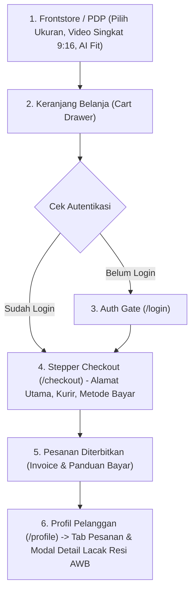
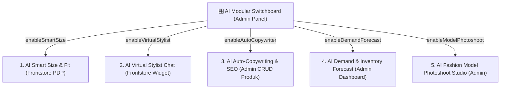
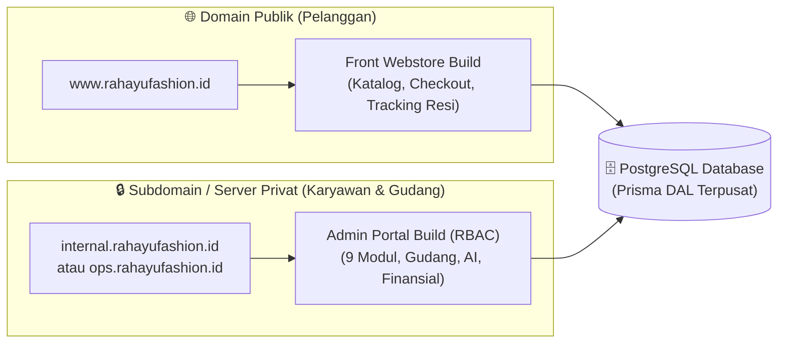
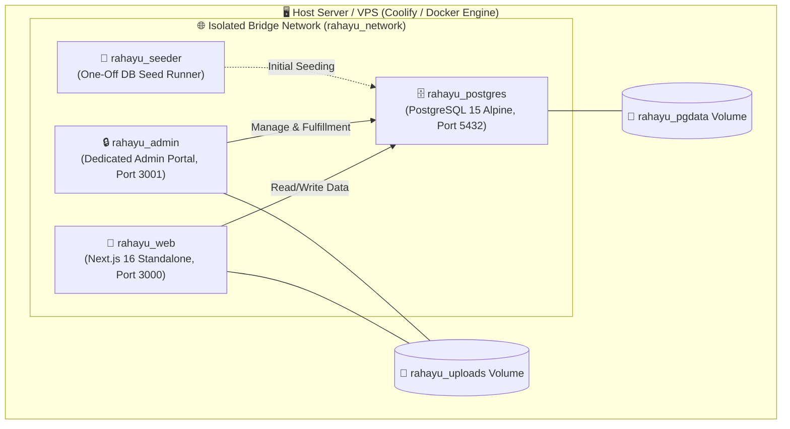

# Master Work Plan & Engineering Blueprint: Rahayu Fashion Store

Dokumen resmi ini memuat roadmap pengerjaan 6-phase yang mendalam, rincian teknis setiap fase, kalkulasi infrastruktur server bulanan (OPEX), integrasi pipeline AI modular lepas-pasang, integrasi statistik TikTok Live, dan panduan teknis implementasi untuk single fullstack engineer.

---

## 1. Roadmap & Milestone Pengerjaan (6-Phase Implementation)

| Phase | Estimasi Durasi | Ruang Lingkup & Detail Deliverables | Status |
| :--- | :---: | :--- | :---: |
| **Phase 1** | Minggu 1 | **Foundations, Skema Data & Storefront Hijup Base**<br>• Setup Next.js 16 (App Router), Tailwind CSS 4, TypeScript, Lucide Icons.<br>• Fondasi State Management (`StoreContext.tsx`) dan mock data komprehensif (`mock-data.ts`).<br>• Desain skema Prisma (`schema.prisma` mencakup `User`, `CustomerAddress`, `Category`, `Product`, `Order`, `PaymentMethodConfig`).<br>• Storefront editorial ala Hijup.com: 11 Kategori Resmi circular portrait, Hero Banner dengan background uploader & slider kontras, section dinamis (Produk Terbaru, Terlaris, Flash Sale Highlight Countdown), video vertikal PDP 9:16, TikTok live alert, halaman katalog produk mandiri (`/products`), dan Footer SEO. | ✅ **Selesai** |
| **Phase 2** | Minggu 2–3 | **Alur Belanja Tokopedia Standard, Halaman Profile & Admin Control Panel (9 Modul & RBAC)**<br>• **Pemisahan Akses & Auth Portal:** Login Pelanggan Toko (`/login`) vs Portal Internal Admin Khusus Karyawan & Gudang (`/admin/login`) dengan Role-Based Access Control (RBAC 5 Peran: Super Admin, Product Merchandiser, Gudang & Resi AWB, Marketing Live, Finance Ops), Quick Role Switcher, dan Lock Indicator modul sensitif.<br>• **Alur Pembeli:** Auth Gate Login/Register (`/login`), Keranjang Belanja interaktif (*Cart Drawer*), Stepper Checkout (`/checkout`) dengan pilihan alamat, kurir (JNE/SiCepat/J&T/AnterAja), metode bayar, dan voucher.<br>• **Halaman Profil Pelanggan (`/profile`):** Edit profil & upload foto avatar ke server lokal (`/public/uploads/`), Tag Lokasi Alamat (*Rumah, Kantor, Apartemen, Toko*), Tab Pesanan Fancy dengan 4 status (*Menunggu Pembayaran, Dikemas, Dikirim, Selesai*), serta **Modal Popup Detail Pesanan** (instruksi pembayaran step-by-step dinamis dari database, info packing gudang, resi AWB kurir dengan copy button & linimasa live tracking, dan konfirmasi selesaikan pesanan).<br>• **Admin Control Panel (`/admin` - 9 Modul Lengkap):**<br>  1. *Dashboard & Analisa Penjualan:* KPI Omzet, AOV, Grafik Tren 7 Hari (toggle Omzet vs Qty), dan Realtime Stock Monitor dengan alert stok menipis (&lt;20 pcs) & quick restock.<br>  2. *Master Kategori & Kelompok Dinamis:* CRUD kategori, icon foto upload server, preset ukuran, dan CRUD kelompok kategori tanpa kata "pilar".<br>  3. *Katalog Produk & Video PDP:* CRUD produk, SKU, stok, badge promo kustom, attach kampanye promo, dan video 9:16.<br>  4. *Pesanan & Nomor Resi Kurir (AWB):* Tab alur pesanan sinkron webfront (*Semua, Menunggu Pembayaran, Dikemas, Dikirim, Selesai*).<br>  5. *Payment Gateway Control Panel:* Biaya admin, no rekening/VA, upload QRIS, dan editor panduan instruksi pembayaran step-by-step dinamis.<br>  6. *Promo & Flash Sale Manager:* Kode voucher diskon & countdown timer promo highlight.<br>  7. *Pusat Fitur AI & Switchboard Lepas-Pasang:* 5 fitur AI modular non-mandatory (Smart Size Recommender, Virtual Stylist Chatbot, Auto-Copywriting SEO, Demand & Seasonal Forecast, Model Photoshoot Studio di form produk, serta arsip riwayat render).<br>  8. *SEO CMS & TikTok Live Schedule:* Konfigurasi meta SEO, silo keywords, Schema.org ClothingStore, dan tautan medsos resmi.<br>  9. *Tata Letak & Section Beranda:* Pengaturan teks hero banner, custom background uploader, slider opacity, kontrol visibilitas section beranda, dan 4 kartu USP.<br>• In-house Server Image Uploader (`/api/upload` ➔ `/public/uploads/` dengan batas 5 MB & preview thumbnail). | ✅ **Selesai** |
| **Phase 3** | Minggu 4 | **Database Persistence, API Handlers, Docker Multi-Target & Mobile App Scaffolding**<br>• **Migrasi Database PostgreSQL & Prisma:** Menghubungkan skema Prisma ke database PostgreSQL fisik (Docker container / VPS Cloud), membuat skrip inisialisasi & auto-seed tanpa ketergantungan CLI (`prisma/init-db.mjs`), serta skrip `prisma/seed.ts` untuk 11 kategori, kelompok kategori, katalog produk awal, user admin & demo customer, serta metode pembayaran awal.<br>• **Pemisahan Docker Development vs Production Build:** `docker-compose.yml` (`target: dev`, `NODE_ENV=development`, live HTTP & Prisma query logs + hot-reload) dan `docker-compose.prod.yml` (`target: runner`, `NODE_ENV=production`, Next.js Standalone Engine ~120 MB).<br>• **Prisma Client Data Access Layer (DAL) & Health Check:** Mengganti persistensi in-memory state dengan Prisma Client queries & endpoint `/api/health` untuk pemantauan status PostgreSQL secara live.<br>• **REST API Endpoints & Server Actions:**<br>  - Route `/api/products`: GET filter/search, POST tambah produk, PATCH edit produk/stok, DELETE hapus.<br>  - Route `/api/orders`: GET order list/detail, POST create checkout, PATCH update resi AWB & status kurir.<br>  - Route `/api/categories`: Manajemen kategori & kelompok dinamis.<br>  - Route `/api/payment-methods` & `/api/homepage-config`: Simpan konfigurasi tata letak beranda & payment instructions.<br>  - Sanitasi endpoint `/api/upload` dengan validasi MIME-type (image/png, image/jpeg, image/webp) dan batas ukuran file.<br>• **Inisialisasi Mobile App (React Native Expo SDK 52):** Setup struktur folder project Expo (`packages/mobile`), konfigurasi shared TypeScript types dengan web Next.js, dan bottom-tab navigation scaffolding (Beranda, Katalog, Keranjang, Akun & Lacak Resi). | ✅ **Selesai** |
| **Phase 4** | Minggu 5–6 | **Integrasi Payment Gateway Resmi, Pipeline AI Live & Integrasi Statistik TikTok Live**<br>• **Integrasi Payment Gateway Produksi:** Pemasangan SDK resmi Midtrans Snap / Xendit API (QRIS Dinamis otomatis terverifikasi, Virtual Account BCA/Mandiri/BRI/BNI dengan nomor VA unik, E-Wallet GoPay/ShopeePay, dan Kartu Kredit).<br>• **Webhook Payment Handler:** Endpoint `/api/webhooks/payment` dengan verifikasi signature cryptographic untuk otomatis mengubah status pesanan dari *Menunggu Pembayaran* menjadi *Sedang Dikemas* tanpa intervensi manual admin.<br>• **Pipeline Produksi AI Eksternal:** Menghubungkan OpenAI / Google Gemini API ke modul AI Auto-Copywriter, AI Virtual Stylist chatbot, dan integrasi pipeline AI Virtual Try-On on-model via `fal.ai` / `Replicate` (`BiRefNet` + `IDM-VTON`).<br>• **Integrasi Data Statistik TikTok Live:**<br>  - *Metode A (Real-Time Live Connector):* Menggunakan WebSocket client (`tiktok-live-connector`) untuk membaca metrik siaran langsung secara real-time (jumlah penonton live, likes, komentar produk, interaksi penonton) tanpa memerlukan approval resmi dari TikTok Developer Portal.<br>  - *Metode B (Official TikTok Shop Open API):* Menggunakan TikTok Shop Partner Open API (`/api/orders/search`, `/api/finance/settlements`, `/api/products/statistics`) untuk menarik data omzet kotor, GMV live stream, dan konversi keranjang kuning resmi.<br>  - *Metode C (Sinkronisasi CSV Report Otomatis / Fallback):* Fitur drag-and-drop import file laporan penjualan harian dari TikTok Shop Seller Center ke Dashboard Analisa Admin Rahayu.<br>  - Dashboard analitik live stream di admin yang menampilkan perbandingan omzet webfront vs omzet live TikTok. | ⏳ **Berikutnya** |
| **Phase 5** | Minggu 7–8 | **Quality Assurance, Hardening Keamanan, Arsitektur Dual-Build & Cloudflare CDN**<br>• **Testing & QA Menyeluruh:** End-to-End (E2E) testing alur belanja (Pilih Produk ➔ Keranjang ➔ Checkout ➔ Bayar VA/QRIS ➔ Webhook Verifikasi ➔ Gudang Kemas ➔ Input Resi AWB ➔ Tracking Kurir ➔ Selesai).<br>• **Arsitektur Dual-Build & Isolasi Keamanan:** Pemisahan build independen antara Frontstore Publik (`apps/web`) vs Portal Admin Internal (`apps/admin`) agar pembeli 100% tidak mengetahui rute/bundle admin internal.<br>• **Demo Connector Switchboard:** Saklar `NEXT_PUBLIC_SHOW_DEMO_CONNECTOR=true` (untuk kemudahan evaluasi/demo) dan `false` (saat go-live untuk melenyapkan seluruh jejak admin dari webfront).<br>• **Cloudflare R2 Object Storage Setup:** Pemindahan penyimpanan video vertikal 9:16 dan aset foto produk ke Cloudflare R2 dengan **Rp 0 Egress Bandwidth** (bebas biaya kuota download video).<br>• **Audit Kecepatan & SEO Google:** Optimasi Next.js Image Component (WebP/AVIF), target skor Google PageSpeed Insights &gt;90 di mobile & desktop, serta validasi Rich Snippets Schema.org ClothingStore.<br>• **Security Hardening:** Rate limiting API routes, sanitasi input XSS/SQL Injection, CORS policy, dan secure cookie session storage. | ⏳ Pending |
| **Phase 6** | Minggu 9–11 | **Peluncuran Web Dual-Build (Go-Live) & Build Aplikasi Mobile (Add-on +Rp 7 Juta)**<br>• **Deployment Dual-Build Produksi VPS:** Setup server Ubuntu 24.04 dengan Coolify PaaS / Docker Compose (Opsi A: Subdomain terpisah `www.rahayufashion.id` vs `ops.rahayufashion.id` dengan Cloudflare Zero Trust/IP Whitelist; Opsi B: Monorepo 2 container mandiri dengan PostgreSQL & Redis terpusat).<br>• **Domain & SSL Setup:** Pemasangan domain resmi toko, konfigurasi DNS Cloudflare dengan SSL/TLS Full Strict, dan skrip automated database backup harian ke cloud storage.<br>• **Build & Distribusi Aplikasi Mobile iOS & Android:**<br>  - Build APK & Android App Bundle (AAB) siap rilis ke Google Play Store via Expo Application Services (EAS Build).<br>  - Build IPA iOS untuk pengujian TestFlight & submission ke Apple App Store.<br>  - Integrasi Push Notification pesanan real-time via Firebase Cloud Messaging (FCM) / Expo Push Notifications. | ⏳ Pending |

---

## 2. Rincian Teknis Per Phase

### Phase 1: Foundations, Skema Data & Storefront Hijup Base
1. **Arsitektur Frontstore:**
   - Desain layout responsif bernuansa modest muslimah elegan (*Hijup-style*).
   - Bar 11 Kategori Produk dinamis dengan dukungan upload icon/foto langsung dari admin.
   - Banner Hero beranda dengan background gambar yang dapat diganti sendiri, panduan ukuran standar (1920×640 px), dan slider opacity kontras gelap teks.
   - Halaman katalog produk mandiri (`/products`) dengan filter kategori, rentang harga, ukuran baju, dan sorting (termurah, termahal, terlaris, rating).
   - Pemutar video singkat vertikal 9:16 di PDP modal dan preview showroom TikTok Live.
2. **Desain Skema Database (`prisma/schema.prisma`):**
   - Model `User` (Customer & Admin dengan roles).
   - Model `CustomerAddress` (dengan label, tag lokasi, nomor telepon, dan status alamat utama).
   - Model `Category` (dengan pilar/kelompok dinamis, preset ukuran, warna tema, dan icon image).
   - Model `Product` (dengan SKU, nama, kategori, harga, harga coret, diskon, stok, badge promo kustom, promo campaign, video URL, dan deskripsi).
   - Model `Order` & `OrderItem` (dengan status pembayaran, timeline pelacakan resi kurir, instruksi pembayaran, dan nomor rekening/VA).
   - Model `PaymentMethodConfig` (dengan status aktif, biaya admin, nomor rekening/VA, QRIS image, dan instruksi step-by-step).

### Phase 2: Alur Belanja Tokopedia Standard, Halaman Profile & Admin Control Panel (9 Modul)
1. **Pemisahan Autentikasi & Portal Akses (RBAC Architecture):**
   - **Login Pembeli / Webfront (`/login`):** Khusus pelanggan untuk belanja, kelola alamat, dan pantau resi.
   - **Login Portal Admin Internal (`/admin/login`):** Khusus staf, warehouse, dan management dengan tema enterprise gelap, enkripsi keamanan, dan pemilih 5 peran (RBAC).
   - **5 Peran Resmi Staf (Role-Based Access Control):**
     1. `SUPER_ADMIN` (Hj. Rahayu Kusuma - Owner): Akses penuh tanpa batas ke seluruh 9 modul, AI Switchboard, finansial, dan audit log.
     2. `PRODUCT_MANAGER` (Dewi Lestari - Merchandiser Lead): Kelola Katalog Produk, Studio Foto AI, Auto-Copywriting, Kategori Dinamis, dan Promo Flash Sale (5 Modul).
     3. `ORDER_FULFILLMENT` (Budi Santoso - Kepala Gudang): Pemrosesan pesanan, cetak label, input nomor resi kurir AWB (JNE/SiCepat/J&T), dan monitor stok gudang (3 Modul).
     4. `MARKETING_STREAMER` (Annisa Putri - Host & Live Marketing): Jadwal siaran TikTok Live, banner hero beranda, SEO CMS, dan kupon voucher promo (4 Modul).
     5. `FINANCE_OPS` (Hendra Wijaya - Finance & Settlement): Payment Gateway Control Panel (QRIS, VA, Instruksi Rekening), analisa omzet penjualan, dan verifikasi pesanan (3 Modul).
   - **Mekanisme Keamanan & Fast Role Switcher:**
     - Modul yang tidak diizinkan dikunci otomatis dengan icon 🔒 dan badge *Terkunci*.
     - Modal interaktif *Role Switcher* di header admin untuk simulasi pengujian peran secara instan.
2. **Alur Checkout & Transaksi:**
   - Cart Drawer yang mulus dengan counter badge belanja real-time.
   - Stepper Checkout: Pemilihan alamat utama pembeli, kurir pengiriman (JNE, SiCepat, J&T, AnterAja), metode pembayaran, dan ringkasan biaya.
3. **Halaman Profile Pembeli (`/profile`):**
   - Edit profil biodata dan upload foto avatar pengguna ke server lokal (`/public/uploads/`).
   - Manajemen alamat pengiriman dengan Tag Lokasi (*Rumah, Kantor, Apartemen, Toko*) dan toggle Alamat Utama.
   - Tab Pesanan Fancy dengan 4 status belanja (*Menunggu Pembayaran, Sedang Dikemas, Dalam Pengiriman, Selesai*).
   - Modal Popup Detail Pesanan interaktif dengan flow 4 tahap: panduan pembayaran step-by-step, info status gudang, resi AWB kurir dengan copy button & linimasa live tracking, dan konfirmasi penyelesaian pesanan.
4. **Admin Control Panel 9 Modul (`/admin`):**
   - *Modul 1 (Analisa Penjualan):* Grafik tren 7 hari (toggle Omzet vs Qty) dan Realtime Stock Monitor dengan alert stok tipis (&lt;20 pcs) & quick restock button (+10, +50).
   - *Modul 2 (Kategori & Kelompok):* CRUD kategori, icon image upload server, preset ukuran, dan CRUD kelompok kategori tanpa kata "pilar".
   - *Modul 3 (Katalog Produk):* CRUD produk lengkap, input SKU, harga, stok, badge promo kustom, attach kampanye promo, dan video 9:16.
   - *Modul 4 (Pesanan & Resi):* Tab alur pesanan yang sinkron ke webfront (Verifikasi bayar ➔ Kemas ➔ Input resi ➔ Selesai).
   - *Modul 5 (Payment Gateway):* Pengaturan biaya admin, no rekening/VA, upload QRIS, dan editor panduan instruksi pembayaran step-by-step dinamis.
   - *Modul 6 (Promo & Flash Sale):* Pengaturan voucher diskon dan countdown timer promo highlight.
   - *Modul 7 (Pusat Fitur AI & Switchboard):* 5 fitur AI modular lepas-pasang (Smart Size Recommender, Virtual Stylist Chatbot, Auto-Copywriting SEO, Demand & Seasonal Forecast, Model Photoshoot Studio di form produk, serta arsip riwayat render).
   - *Modul 8 (SEO CMS & Live TikTok):* Pengaturan meta title, meta keywords silo, Schema.org ClothingStore, dan jadwal live TikTok.
   - *Modul 9 (Tata Letak Beranda):* Pengaturan teks hero banner, custom background uploader, slider opacity, kontrol visibilitas section beranda, dan 4 kartu USP.
   - *Server Image Uploader:* Endpoint internal `/api/upload` (menyimpan file di `/public/uploads/` dengan batas 5 MB & preview thumbnail).

### Phase 3: Database Persistence, API Handlers, Docker Multi-Target & Mobile App Scaffolding [SELESAI - 100%]
1. **Migrasi Database PostgreSQL & Skema Relasional Permanen:**
   - Database PostgreSQL 15 berjalan aktif pada port 5432 dengan database `rahayu_fashion`.
   - Skema Prisma ORM v6.19.3 (`prisma/schema.prisma`) disinkronkan dengan 12 tabel relasional:
     - `admin_staff_users` (5 Akun Staf dengan RBAC roles: `SUPER_ADMIN`, `PRODUCT_MANAGER`, `ORDER_FULFILLMENT`, `MARKETING_STREAMER`, `FINANCE_OPS`)
     - `customer_users` & `customer_addresses` (Data akun pelanggan, tier membership, dan buku alamat)
     - `marketplace_pillars` & `categories` (3 Kelompok kategori dan 11 kategori resmi dengan dynamic sizes)
     - `products`, `product_variants`, dan `product_media` (Katalog lookbook, SKU, stok, varian warna/ukuran, video short)
     - `payment_configs` (7 Metode pembayaran dengan instruksi step-by-step dinamis)
     - `orders` (Riwayat transaksi dengan status belanja, snapshots item lengkap dengan nested object `product`, dan tracking timeline)
     - `homepage_configs` (CMS tata letak beranda, hero banner, countdown, USP cards)
     - `ai_generation_logs` (Arsip riwayat render studio foto AI)
   - Skrip inisialisasi mandiri `prisma/init-db.mjs` (menggunakan `@prisma/client` murni tanpa ketergantungan CLI `@prisma/config`/`effect`) secara otomatis membuat skema 12 tabel, memperbaiki format data lama (`itemsJson`), dan mengisi seed data awal saat container menyala.
2. **Pemisahan Docker Development Build vs Production Build:**
   - **`Dockerfile` Multi-Target:**
     - `target: dev` untuk mode Development (`NODE_ENV=development`, `FORCE_COLOR=1`, menjalankan `npx next dev -H 0.0.0.0 -p 3000` dengan output log HTTP request & query SQL Prisma secara real-time).
     - `target: runner` untuk mode Production (`NODE_ENV=production`, Next.js Standalone Server `node server.js` ~120 MB dengan non-root user `nextjs`).
   - **`docker-compose.yml` (Development Build Default):** Menyertakan bind-mount `./src`, `./public`, dan `./prisma` untuk hot-reload instan dan live log di Docker Desktop.
   - **`docker-compose.prod.yml` (Production Standalone Build):** Konfigurasi siap deploy ke VPS / Coolify beserta profil `dual-build` (memisahkan port `3000` untuk pelanggan dan port `3001` untuk staf internal).
3. **REST API Route Handlers & Data Access Layer (DAL):**
   - Menggantikan in-memory state dengan Prisma query methods di backend Next.js App Router:
     - `GET /api/health`: Diagnostik koneksi live PostgreSQL, perhitungan jumlah baris di 12 tabel, dan trigger seeding (`?action=seed`).
     - `GET /api/products` & `POST /api/products`: Listing produk dengan filter kategori/search & penambahan produk baru.
     - `GET`, `PATCH`, `DELETE /api/products/[id]`: Pengambilan detail produk, update stok realtime tim gudang, edit produk, dan soft/hard delete.
     - `GET /api/categories` & `POST /api/categories`: Listing 11 kategori dinamis & penambahan kategori baru.
     - `PATCH`, `DELETE /api/categories/[id]`: Update atribut kategori dan preset ukuran dinamis.
     - `GET /api/orders` & `POST /api/orders`: Pengambilan pesanan & pembuatan pesanan baru (otomatis memotong stok produk di database).
     - `GET`, `PATCH /api/orders/[id]`: Detail pesanan, update status pesanan, dan input nomor resi kurir AWB dengan tracking logs.
     - `GET`, `PATCH /api/payment-methods`: Kontrol status aktif dan biaya admin payment gateway.
     - `GET`, `PATCH /api/homepage-config`: Sinkronisasi konfigurasi tata letak beranda dan countdown promo gajian.
     - `GET`, `POST /api/admin-users`: Listing akun staf admin internal berdasarkan role.
     - `GET`, `POST /api/ai-logs`: Penyimpanan riwayat foto studio AI ke database.
   - Sinkronisasi dua arah pada `StoreContext.tsx`: Pemuatan otomatis data dari database saat aplikasi dimuat (dengan normalisasi struktur `Order`, `Category`, dan `PaymentMethodConfig`) serta persistensi instan (*optimistic UI updates*).
4. **Scaffolding Aplikasi Mobile (React Native Expo SDK 52):**
   - Struktur project mandiri di `packages/mobile/` menggunakan React Native & Expo SDK 52.
   - Konfigurasi bottom-navigation 4 tab utama (`BottomTabNavigator.tsx`):
     - 🏠 **Beranda (`HomeScreen.tsx`):** Hero editorial Hijup, badge siaran TikTok Live, 11 kategori resmi horizontal scroll, banner promo highlight, dan produk terlaris.
     - 👗 **Katalog (`CatalogScreen.tsx`):** Filter tab kategori horizontal, input pencarian live, grid 2 kolom dengan badge promo dan status stok.
     - 🛍️ **Keranjang (`CartScreen.tsx`):** Manajemen kuantitas belanja, auto-apply voucher `RAHAYUPAYDAY`, rincian ongkos kirim JNE/SiCepat, dan sticky checkout CTA bar.
     - 👤 **Akun & Lacak Resi (`AccountScreen.tsx`):** Profil Siti Rahmawati (Gold Member, 1.250 Poin), filter status pesanan, dan **Lacak Nomor Resi Kurir (AWB)** dengan linimasa status ekspedisi real-time dari database PostgreSQL.
   - API Client mobile (`packages/mobile/src/api/client.ts`) yang terhubung langsung ke backend Next.js.
   - Dokumentasi lengkap panduan menjalankan aplikasi di iOS, Android, dan Expo Go (`packages/mobile/README.md`).

### Phase 4: Integrasi Payment Gateway, Pipeline AI & API Statistik TikTok Live
1. **Integrasi Payment Gateway:**
   - Pemasangan Midtrans Snap / Xendit API resmi untuk pembayaran otomatis (QRIS Dinamis, BCA/Mandiri/BRI VA, E-Wallet, Kartu Kredit).
   - Webhook listener `/api/webhooks/payment` dengan verifikasi signature cryptographic untuk otomatis mengubah status pesanan dari *Menunggu Pembayaran* menjadi *Sedang Dikemas*.
2. **Pipeline AI Eksternal:**
   - Menghubungkan Google Gemini / OpenAI API untuk Auto-Copywriting dan AI Virtual Stylist chatbot.
   - Integrasi pipeline image virtual try-on on-model live via `fal.ai` / `Replicate` (`BiRefNet` + `IDM-VTON`).
3. **Integrasi Data Statistik TikTok Live:**
   - *Pilihan A (Real-Time WebSocket `tiktok-live-connector`):* Membaca penonton live, likes, dan komentar langsung dari siaran live TikTok @rahayufashion.store tanpa registrasi developer portal.
   - *Pilihan B (Official TikTok Shop Open API):* Menarik metrik GMV resmi, produk etalase paling laris, dan konversi checkout live shopping.
   - *Pilihan C (CSV Report Importer):* Fallback import laporan harian dari TikTok Seller Center ke dashboard analisa admin.

### Phase 5: Quality Assurance, Hardening Keamanan, Arsitektur Dual-Build & Cloudflare CDN
1. **Testing & QA Menyeluruh:**
   - Pengujian End-to-End (E2E) alur belanja dari checkout pembeli hingga resi kurir diterima.
   - Pengujian beban (*load testing*) untuk menangani lonjakan checkout saat siaran TikTok Live berlangsung.
2. **Arsitektur Dual-Build & Isolasi Akses:**
   - Penyiapan opsi build terpisah antara Frontstore Web (`apps/web`) dan Admin Portal (`apps/admin`).
   - Saklar konektor demo: `NEXT_PUBLIC_SHOW_DEMO_CONNECTOR=true` (mode demo aktif) vs `false` (mode produksi tersembunyi total).
   - Pengujian middleware proteksi domain untuk me-return 404 pada URL admin di domain publik.
3. **Cloudflare R2 Object Storage:**
   - Menghubungkan penyimpanan foto produk dan video 9:16 ke Cloudflare R2 dengan **Rp 0 Egress Bandwidth** (bebas biaya kuota unduh video).
4. **Audit Kecepatan & SEO:**
   - Target skor Google PageSpeed Insights &gt;90 di mobile & desktop.
   - Validasi Google Rich Results untuk produk pakaian dan toko resmi.

### Phase 6: Peluncuran Web Dual-Build (Go-Live) & Build Aplikasi Mobile (Add-on)
1. **Deployment Dual-Build Produksi (Go-Live):**
   - Setup VPS Ubuntu 24.04 dengan Coolify PaaS / Docker Compose (Next.js multi-container / multi-subdomain + PostgreSQL + Redis).
   - Opsi A: Subdomain terpisah (`www.rahayufashion.id` vs `internal.rahayufashion.id`) dengan proteksi Cloudflare Zero Trust / IP Whitelist kantor & gudang.
   - Opsi B: Monorepo 2 container independen (`build:web` vs `build:admin`) terhubung ke PostgreSQL Prisma terpusat.
   - Pemasangan domain resmi toko, SSL HTTPS otomatis, dan backup database otomatis harian.
2. **Build & Distribusi Mobile App (+Rp 7 Juta):**
   - Build file installer Android (APK / AAB) dan iOS (IPA / TestFlight) menggunakan EAS Build.
   - Pengaturan notifikasi push order (*Order Status Push Notifications*).

---

## 3. Rincian Biaya Operasional (Server OPEX & AI Photoshoot)

### A. Biaya Server & Infrastruktur (Target: Rp 500.000 – Rp 1.000.000 / Bulan)
* **VPS Utama (Hetzner / DigitalOcean / Biznet Gio)**:
  * Spek: 4 vCPU, 8 GB RAM, 80 GB NVMe SSD.
  * OS: Ubuntu 24.04 LTS + Coolify PaaS (Docker Next.js + PostgreSQL + Redis).
  * Biaya: **~Rp 320.000 – Rp 480.000 / bulan**.
* **Cloudflare R2 Object Storage (Video PDP & Foto Produk)**:
  * 10 GB free storage, **Rp 0 Egress Bandwidth** (bebas biaya kuota bandwidth download video).
  * Biaya: **Rp 0 – Rp 50.000 / bulan**.
* **WhatsApp Notification Gateway (Fonnte / Wablas)**:
  * Notifikasi nomor resi pengiriman kurir ke pembeli.
  * Biaya: **~Rp 85.000 / bulan**.
* **Total OPEX Server Bulanan: ~Rp 405.000 – Rp 615.000 / bulan** (Aman di dalam batas anggaran maksimal Rp 1.000.000/bln).

### B. Biaya Studio Foto Model AI (On-Demand Pay-per-Use)
* Menggunakan pipeline image generation modern (`BiRefNet` background removal + `IDM-VTON` virtual try-on on-model via `fal.ai` / `Replicate`).
* Rata-rata biaya: **$0.03 – $0.04 USD** per foto rendered (**~Rp 480 – Rp 650 / foto**).
* Untuk 300 foto katalog baru per bulan: **~Rp 150.000 – Rp 195.000**.
* Jauh lebih hemat dibandingkan biaya sewa fotografer studio + model fisik (Rp 3.000.000 – Rp 5.000.000 per sesi).

---

## 4. Alur Transaksi & Pengalaman Pengguna (Tokopedia & Hijup Standard)



---

## 5. Ringkasan 9 Modul Control Panel Admin

1. **Dashboard & Analisa Penjualan**: KPI Omset kotor, total pesanan, AOV, Grafik Tren 7 Hari (toggle Omzet vs Qty), dan Realtime Stock Monitor dengan alert stok menipis (&lt;20 pcs) & quick restock.
2. **Kategori & Kelompok Dinamis**: CRUD Kategori, icon image upload server, preset ukuran, dan CRUD kelompok kategori tanpa kata "pilar".
3. **Katalog Produk & Video PDP**: Input produk, SKU, harga, stok, badge promo kustom, attach kampanye promo, dan video 9:16.
4. **Pesanan & Input Resi Kurir (AWB)**: Tab alur pesanan sinkron webfront (*Semua, Menunggu Pembayaran, Dikemas, Dikirim, Selesai*).
5. **Payment Gateway Control Panel**: Pengaturan biaya admin, no rekening/VA, upload QRIS, dan editor panduan instruksi pembayaran step-by-step dinamis.
6. **Promo & Flash Sale Manager**: Pengaturan voucher diskon dan countdown timer promo highlight.
7. **Pusat Fitur AI & Switchboard Lepas-Pasang**: 5 fitur AI modular non-mandatory (Smart Size Recommender, Virtual Stylist Chatbot, Auto-Copywriting SEO, Demand & Seasonal Forecast, Model Photoshoot Studio di form produk, serta arsip riwayat render).
8. **SEO CMS & Live TikTok**: Konfigurasi meta SEO, silo keywords, Schema.org ClothingStore, tautan medsos resmi, dan jadwal live TikTok.
9. **Tata Letak & Section Beranda**: Pengaturan teks hero banner, custom background uploader, slider opacity, kontrol visibilitas section beranda, dan 4 kartu USP.

---

## 6. Spesifikasi 5 Fitur AI Modular & Contoh Kasus Nyata



### 1. AI Smart Size & Fit Recommender
* **Lokasi Fitur:** Halaman Detail Produk (PDP Modal di Webfront & Mobile).
* **Tujuan & Manfaat:** Mengatasi keraguan pembeli dalam memilih ukuran baju online, meningkatkan konversi penjualan (*checkout conversion*), dan menekan angka retur baju hingga 40%.
* **Mekanisme Lepas-Pasang:** Saklar `enableSmartSize` di admin. Jika dimatikan, tombol AI disembunyikan sepenuhnya.
* **Contoh Kasus Nyata:**
  * **Input Pelanggan:** Tinggi Badan: `162 cm`, Berat Badan: `58 kg`, Gaya: `Loose / Syar'i`.
  * **Output AI ke Pelanggan:**
    > **Rekomendasi AI: Ukuran L (Tingkat Kecocokan 94%)**  
    > *"Proporsi lingkar dada longgar dan panjang baju jatuh tepat di atas mata kaki, memberikan ruang gerak syar'i yang anggun dan tidak menjiplak bentuk tubuh."*  
    > *(Tersedia tombol satu-klik "Pilih Ukuran L" yang langsung memilih ukuran tersebut).*

### 2. AI Virtual Stylist & Outfit Matcher ("Tanya Stylist Rahayu")
* **Lokasi Fitur:** *Floating Action Button* di pojok kanan bawah seluruh halaman publik Webfront.
* **Tujuan & Manfaat:** Menjadi asisten belanja personal ramah muslimah yang memberikan saran padu padan warna jilbab, gamis, dan aksesoris, sehingga meningkatkan nilai transaksi belanja (*cross-selling*).
* **Mekanisme Lepas-Pasang:** Saklar `enableVirtualStylist` di admin. Jika dimatikan, widget tidak dimuat di browser.
* **Contoh Kasus Nyata:**
  * **Input Pelanggan:** *"Sis, aku mau beli Gamis Silk Lilac, bagusnya dipadukan sama jilbab warna apa ya untuk kondangan siang?"*
  * **Output AI ke Pelanggan:**
    > *"Assalamu'alaikum Sis! ✨ Untuk nuansa **Gamis Silk Lilac**, padanan terbaik adalah jilbab warna **Muted Khaki, Dusty Rose, atau Broken White**. Warna-warna ini memberikan kontras lembut yang anggun tanpa membuat tampilan terlihat mencolok di siang hari. Ini koleksi jilbab silk dan voal yang sangat serasi:"*  
    > *(Menampilkan 2 kartu produk jilbab terkait lengkap dengan foto, harga, dan tombol `+ Beli` langsung ke keranjang).*

### 3. AI Auto-Copywriting & Tagging SEO
* **Lokasi Fitur:** Formulir Tambah & Edit Produk Admin (`src/app/admin/page.tsx`).
* **Tujuan & Manfaat:** Membantu admin menyusun deskripsi produk yang puitis, persuasif, memiliki spesifikasi standar butik, serta ramah mesin pencari Google dan algoritma media sosial (TikTok/Instagram) dalam hitungan 3 detik.
* **Mekanisme Lepas-Pasang:** Saklar `enableAutoCopywriter` di admin. Jika dimatikan, admin mengetik deskripsi secara manual.
* **Contoh Kasus Nyata:**
  * **Input Data Produk:** Nama Produk: `Amira Armani Silk Pleated Tunic`, Kategori: `Atasan Muslim Wanita`.
  * **Output AI ke Formulir Admin:**
    ```text
    Amira Armani Silk Pleated Tunic dirancang khusus untuk wanita muslimah modern yang mengutamakan keanggunan, kenyamanan, dan nilai kesopanan syar'i. Dibuat dengan siluet jatuh (flowy) yang elegan dan tidak menjiplak lekuk tubuh.

    Keunggulan & Spesifikasi:
    • Material Utama: Premium High-Grade Fabric bertekstur halus, adem, menyerap keringat, dan tidak menerawang.
    • Akses Resleting: Resleting depan tersembunyi (Busui Friendly) yang praktis dan rapi.
    • Desain Lengan: Manset elastis manis (Wudhu Friendly) yang mudah dinaikkan saat berwudhu.
    • Fitur Tambahan: Saku samping fungsional kanan-kiri yang tersembunyi rapi.
    • Rekomendasi Pemakaian: Ideal untuk busana kondangan, pesta keluarga, pengajian formal, hingga daily modest look.

    Petunjuk Perawatan:
    Cuci dengan tangan atau putaran mesin lembut suhu air normal. Hindari pemutih pakaian, jemur di tempat teduh, dan setrika dengan suhu sedang untuk menjaga kelembutan serat kain.

    #RahayuFashion #AtasanMuslimWanita #BusanaMuslimah #ModestOOTD #BusuiFriendly #HijabChic
    ```

### 4. AI Demand & Seasonal Inventory Forecast
* **Lokasi Fitur:** Dashboard Analisa Admin (`/admin` ➔ Modul Analisa).
* **Tujuan & Manfaat:** Mencegah terjadinya *stockout* (kehabisan stok produk laris saat live/promo) dan *overstock* (modal tertahan pada produk lambat laku) dengan analisis prediksi musiman.
* **Mekanisme Lepas-Pasang:** Saklar `enableDemandForecast` di admin.
* **Contoh Kasus Nyata:**
  * **Analisis Data Penjualan:** Data historis mendeteksi kecepatan checkout rata-rata 12 pcs/hari pada SKU Gamis, sementara stok tersisa hanya 14 pcs. Periode berada di H-20 menjelang musim Ramadhan.
  * **Output AI di Dashboard Admin:**
    > **Prediksi Lonjakan Musim Ramadhan:** Diproyeksikan terjadi lonjakan pesanan **+185%** dalam 2–3 minggu ke depan. Disarankan menaikkan *safety stock* minimal **2.5× lipat**.  
    > **Risiko Kehabisan Stok (< 20 Pcs):**  
    > • *Gamis Silk Lilac* — Sisa 14 pcs: **Diprediksi habis dalam 24–36 jam!**  
    > • *Tunik Royal Plum* — Sisa 8 pcs: **Diprediksi habis dalam 8 jam!**  
    > *(Tersedia tombol satu-klik "Ajukan PO Restock Otomatis (+50 Semua SKU Kritis)" untuk menambah kuota stok).*

### 5. AI Fashion Model Photoshoot Studio
* **Lokasi Fitur:** Terintegrasi langsung di Formulir Tambah & Edit Produk (CRUD Produk) pada tab *"✨ Buat dengan AI"* serta arsip riwayat render di menu *"Pusat Fitur AI & Switchboard"*.
* **Tujuan & Manfaat:** Menghasilkan foto katalog *on-model* berkualitas editorial profesional langsung dari foto pakaian mentah (*flatlay* lantai atau manekin gantung), menghemat 90% biaya sewa studio dan model foto jutaan rupiah.
* **Mekanisme Lepas-Pasang:** Saklar `enableModelPhotoshoot` di admin. Jika dimatikan, admin mengunggah foto manual ke server lokal.
* **Contoh Kasus Nyata (5-Step Wizard):**
  1. *Langkah 1 (Upload Raw):* Admin mengunggah foto baju gamis di atas hanger.
  2. *Langkah 2 (Pilih Persona):* Admin memilih model *"Wanita Hijabi Modest Editorial"*.
  3. *Langkah 3 (Pilih Tone & Lighting):* Admin memilih nuansa *"Warm Sunlight Golden Hour"*.
  4. *Langkah 4 (Generate & Preview):* Sistem AI menghasilkan visual foto model muslimah mengenakan gamis tersebut dengan proporsi tubuh natural dan pencahayaan studio komersial.
  5. *Langkah 5 (Terapkan):* Tombol *"Gunakan Foto Hasil AI Ini"* langsung memasang foto tersebut ke katalog produk yang sedang diedit.

---

## 7. Arsitektur Dual-Build & Strategi Isolasi Akses Produksi (Frontstore vs Admin)

Untuk menjamin keamanan tingkat tinggi dan kerahasiaan operasional toko, sistem Rahayu Fashion Store dirancang agar dapat **dibangun menjadi 2 aplikasi/build independen**. Hal ini mencegah pelanggan atau pihak luar mengetahui rute, struktur tabel internal, atau mengakses antarmuka internal admin.



### A. 2 Pilihan Strategi Build & Deployment

| Aspek | Opsi A: Subdomain Terpisah & Middleware Whitelisting | Opsi B: Monorepo Multi-Apps (Dual-Build Murni) |
| :--- | :--- | :--- |
| **Penyimpanan Kode** | Single Next.js Project (Monolith Cepat) | Monorepo (`apps/web` & `apps/admin`) |
| **Output Build** | 1 Deployment dengan Domain Routing | 2 Build Artifact Independen (`build:web` & `build:admin`) |
| **Domain Toko Publik** | `www.rahayufashion.id` (Akses `/admin` me-return 404) | `www.rahayufashion.id` (0 KB kode admin) |
| **Domain Admin Internal**| `ops.rahayufashion.id` / `internal.rahayufashion.id` | Server internal terpisah / Cloudflare Zero Trust |
| **Konektivitas Database**| Prisma Client DAL langsung | Shared package `@rahayu/database` |
| **Tingkat Kompleksitas** | ⭐ Rendah (Rekomendasi Tahap Awal) | ⭐⭐⭐ Tinggi (Standar Enterprise Unicorn) |

### B. Mekanisme Demo Connector Lepas-Pasang

Untuk memfasilitasi fase peninjauan klien dan demo saat ini tanpa mengorbankan privasi produksi di masa depan, sistem telah dilengkapi dengan variabel lingkungan kontrol:

```env
# File: .env.production
# Set "true" saat presentasi / demo klien: Tautan "Portal Admin" di topbar & /login aktif
# Set "false" saat peluncuran toko resmi: Seluruh tautan & rute admin hilang total dari pandangan publik
NEXT_PUBLIC_SHOW_DEMO_CONNECTOR=false
```

* **Ketika `NEXT_PUBLIC_SHOW_DEMO_CONNECTOR=true` (Default Demo Saat Ini):**
  * Tautan shortcut *"Portal Admin"* tampil di bar pengumuman teratas.
  * Kotak panduan login staf tampil di halaman `/login` pelanggan.
  * Penguji dapat berpindah peran (Super Admin, Gudang, Merchandiser, Marketing, Finance) dengan 1 klik.
* **Ketika `NEXT_PUBLIC_SHOW_DEMO_CONNECTOR=false` (Mode Produksi Go-Live):**
  * Tautan dan banner admin **dihapus 100% dari DOM HTML** pelanggan.
  * Rute publik tidak menyisakan petunjuk URL admin apapun kepada pembeli.

---

## 8. Arsitektur Containerization Docker & Orkestrasi Produksi

Untuk memastikan portabilitas maksimal antar server (VPS Ubuntu, Coolify PaaS, AWS, Hetzner, atau DigitalOcean), aplikasi telah dilengkapi arsitektur containerization Docker:



### A. Rincian Multi-Stage Dockerfile (`Dockerfile`)
* **Base Stage:** `node:20-alpine` dengan paket `libc6-compat` dan `openssl` untuk kompatibilitas native binary Prisma dan Turbopack.
* **Deps Stage:** `npm ci` dan eksekusi `npx prisma generate` untuk mengkompilasi Prisma engine khusus platform Linux Alpine.
* **Builder Stage:** Kompilasi Next.js dengan opsi `output: "standalone"` yang mengekstrak modul dependensi penting ke folder `.next/standalone`.
* **Runner Stage:** Image produksi minimalis yang dijalankan oleh user unprivileged `nextjs:nodejs` (UID 1001) tanpa akses root, menghasilkan bobot image sangat hemat: **~120 MB** (turun 88% dari image standar Node.js ~1 GB).
* **Entrypoint Script (`docker-entrypoint.sh`):** Otomatis memverifikasi kesiapan koneksi database PostgreSQL dan mengeksekusi `prisma db push` sebelum menyalakan server Next.js.

### B. Opsi Layanan Docker Compose (`docker-compose.yml`)
1. **Layanan Standar (Single-Command Launch):**
   ```bash
   docker compose up -d --build
   ```
   Menjalankan kontainer database PostgreSQL (`rahayu_postgres`) dan aplikasi webstore terpadu (`rahayu_web` di port 3000).
2. **Layanan Seeding Database Otomatis:**
   ```bash
   docker compose --profile seed run --rm seeder
   ```
   Menjalankan container seeder sekali pakai yang mengisi 11 kategori, produk lookbook, 5 akun staf RBAC, akun pembeli, dan metode pembayaran.
3. **Layanan Dual-Build Terisolasi (Production Split):**
   ```bash
   docker compose --profile dual-build up -d
   ```
   Menjalankan dua kontainer terpisah:
   * Kontainer `rahayu_web` (Port 3000): Webfront belanja publik.
   * Kontainer `rahayu_admin` (Port 3001): Internal Admin Portal dengan proteksi RBAC dan opsi Cloudflare Zero Trust / IP Whitelist.

