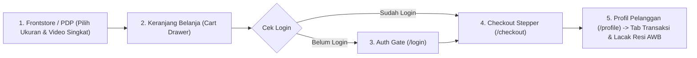

# Master Work Plan & Engineering Blueprint: Rahayu Fashion Store

Dokumen internal ini memuat roadmap pengerjaan 6-phase, kalkulasi infrastruktur server bulanan (OPEX), estimasi biaya AI Photoshoot, arsitektur teknis, dan catatan teknis pelaksanaan untuk single fullstack engineer.

---

## 1. Roadmap Pengerjaan (6-Phase Implementation)

| Phase | Durasi Estimasi | Ruang Lingkup & Deliverables | Status |
| :--- | :---: | :--- | :---: |
| **Phase 1** | Minggu 1 | **Foundations, 11 Kategori & Storefront Hijup Base** • Setup Next.js 16, Tailwind CSS 4, TypeScript, Lucide Icons. • Desain skema Prisma (`User`, `Category`, `Product`, `Order`, `PaymentMethodConfig`). • Storefront editorial ala Hijup.com, 11 Kategori Resmi circular portrait, 3:4 lookbook cards, video 9:16 player modal, TikTok live alert, dan Footer SEO. | **Selesai** |
| **Phase 2** | Minggu 2–3 | **Alur Belanja Tokopedia Standard & Admin Control Panel (8 Modul)** • Auth Gate & Login Customer (`/login`) dengan 1-click Fast Demo credentials. • Alur Checkout Tokopedia (`/checkout`): Pilihan multi-alamat, kurir JNE/SiCepat/J&T/AnterAja, payment methods, dan voucher. • Halaman Profil Pelanggan (`/profile`): Tab transaksi pesanan dan **Pelacakan Resi Kurir (AWB) Real-Time**. • Admin Control Panel (`/admin`): 8 Modul operasional lengkap (Analisa Penjualan, Ukuran Dinamis Kategori, Katalog & Video PDP, Dispatcher Resi Kurir, Toggle Payment Gateway, Promo Manager, Studio Foto Model AI ~Rp 500/foto, dan SEO CMS). | **Selesai** |
| **Phase 3** | Minggu 4 | **Database Persistence, API Handlers & Mobile App Scaffolding** • Prisma Client migrations & seeding script (`prisma/seed.ts`) 11 kategori & produk dummy persisten. • Server Actions / REST API endpoints untuk pesanan, kurir, dan nomor resi. • Inisialisasi React Native Expo SDK 52 monorepo/app untuk iOS & Android. | ⏳ **Berikutnya** |
| **Phase 4** | Minggu 5–6 | **Integrasi Payment Gateway & Webhooks** • Integrasi Midtrans / Xendit Snap & Core API (QRIS, VA BCA/Mandiri/BRI, Kartu Kredit). • Webhook handler untuk auto-verifikasi pembayaran dan update status pesanan real-time. | ⏳ Pending |
| **Phase 5** | Minggu 7–8 | **Quality Assurance, SEO Audit & Cloudflare Zero-Cost CDN** • Audit PageSpeed Lighthouse (>90 score) & verifikasi Schema.org Google Rich Results. • Setup Cloudflare R2 untuk penyimpanan video & foto produk tanpa biaya egress bandwidth. • Hardening keamanan & optimasi resource server agar tetap dalam budget Rp 500rb–1jt/bln. | ⏳ Pending |
| **Phase 6** | Minggu 9–11 | **Go-Live & Mobile App Build (Add-on +Rp 7 Juta)** • Deployment VPS production dengan Coolify / Docker. • Build APK/AAB Android & IPA iOS via Expo Application Services (EAS Build). | ⏳ Pending |

---

## 2. Alur Pengalaman Pengguna (Standar Tokopedia & Hijup)

Navigasi bar di Frontstore murni menampilkan 11 Kategori Produk & Promo Highlight. Seluruh proses transaksi, pemesanan, dan pelacakan resi kurir berada di alur e-commerce terpisah:

---

## 3. Rincian Biaya Operasional (Server OPEX & AI Photoshoot)

### A. Biaya Server & Infrastruktur (Target: Rp 500.000 – Rp 1.000.000 / Bulan)
* **VPS Utama (Hetzner / DigitalOcean / Biznet Gio)**:
  * Spek: 4 vCPU, 8 GB RAM, 80 GB NVMe SSD.
  * OS: Ubuntu 24.04 LTS + Coolify PaaS (Docker Next.js + PostgreSQL + Redis).
  * Biaya: **~Rp 320.000 – Rp 480.000 / bulan**.
* **Cloudflare R2 Object Storage (Video PDP & Foto Produk)**:
  * 10 GB free storage, **Rp 0 Egress Bandwidth** (bebas biaya kuota bandwidth download video).
  * Biaya: **Rp 0 – Rp 50.000 / bulan**.
* **WhatsApp Notification Gateway (Fonnte / Wablas)**:
  * Notifikasi nomor resi pengiriman kurir ke pembeli.
  * Biaya: **~Rp 85.000 / bulan**.
* **Total OPEX Server Bulanan: ~Rp 405.000 – Rp 615.000 / bulan** (Aman dalam batas anggaran maksimal Rp 1.000.000/bln).

### B. Biaya Studio Foto Model AI (On-Demand Pay-per-Use)
* Menggunakan pipeline image generation modern (`BiRefNet` background removal + `IDM-VTON` virtual try-on on-model via `fal.ai` / `Replicate`).
* Rata-rata biaya: **$0.03 – $0.04 USD** per foto rendered (**~Rp 480 – Rp 650 / foto**).
* Untuk 300 foto katalog baru per bulan: **~Rp 150.000 – Rp 195.000**.
* Jauh lebih hemat dibandingkan biaya sewa fotografer studio + model fisik (Rp 3.000.000 – Rp 5.000.000 per sesi).

---

## 4. Arsitektur 8 Modul Control Panel Admin

1. **Dashboard & Analisa Penjualan**: KPI Omset kotor, total pesanan, AOV, dan konversi penonton TikTok Live.
2. **Kategori & Ukuran Dinamis**: Admin dapat mengatur preset ukuran (`S/M/L`, `cm`, `All Size`) per 11 kategori yang otomatis tersinkron ke PDP.
3. **Katalog Produk & Video Singkat**: Input produk, SKU, harga, stok, badge promo, dan link video 9:16.
4. **Pesanan & Input Resi Kurir (AWB)**: Status updater dan input nomor resi kurir (JNE/SiCepat/J&T) yang langsung dapat dilacak pembeli di `/profile`.
5. **Payment Gateway Control Panel**: Toggle aktivasi QRIS, Virtual Account bank, CC, COD, dan pengaturan biaya admin.
6. **Promo & Flash Sale Manager**: Pengaturan kode voucher dan timer flash sale highlight.
7. **Studio Foto Model AI**: Generator foto produk on-model AI dengan kalkulator biaya transparan per generate.
8. **SEO CMS & TikTok Live**: Konfigurasi meta tag, Schema.org ClothingStore, tautan medsos resmi, dan status siaran langsung TikTok Live.
